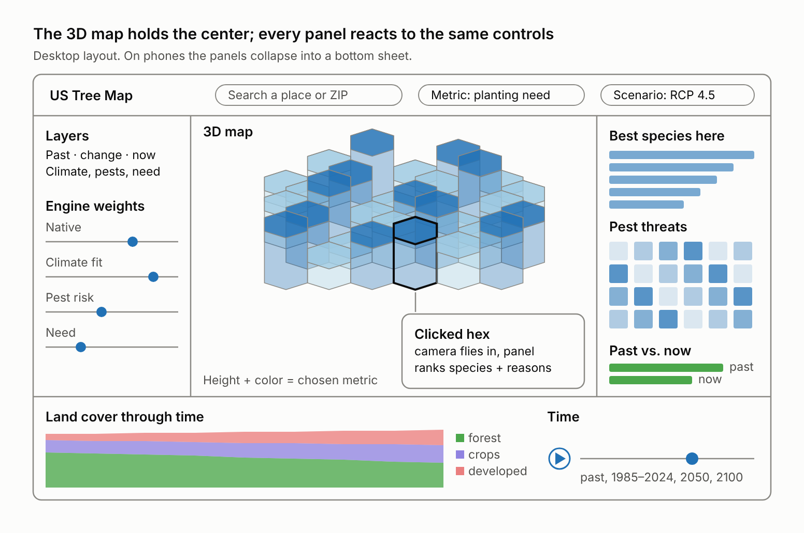
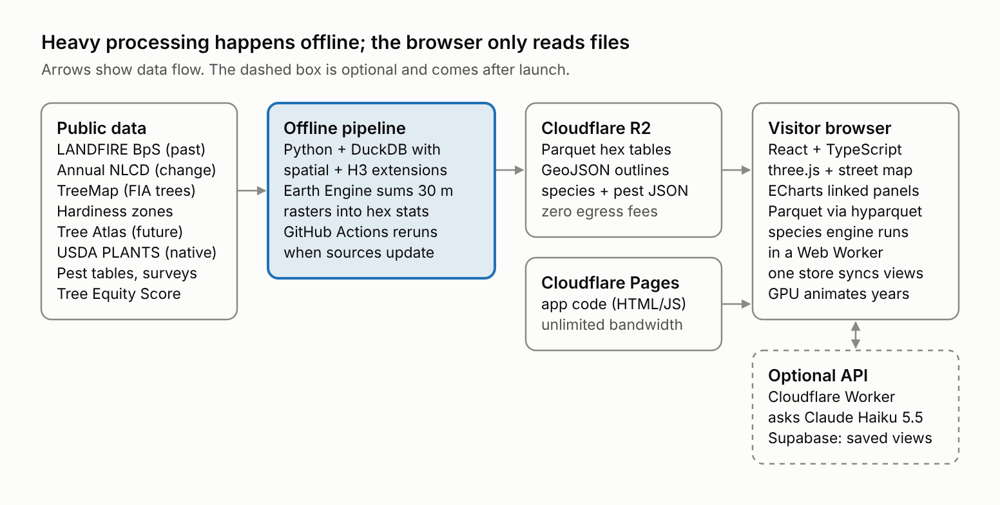
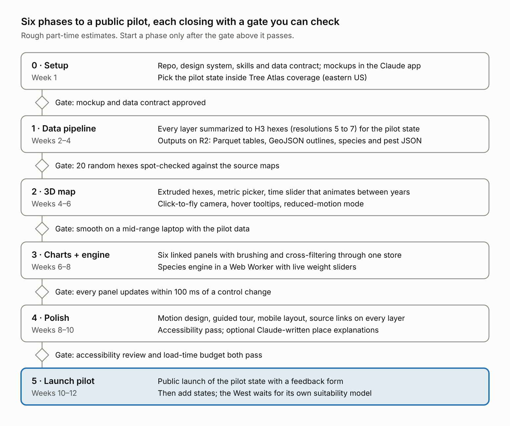

# US Tree Map: Full Build Plan

Exported from the planning doc ([claude.ai artifact](https://claude.ai/artifact/KKQLReSxhRRABABatHAHCh)), Oct 26, 2026, plus corrections checked Oct 27, 2026.

An animated 3D map of US tree history, climate fit and pest risk with linked charts, built static-first so it stays free to run.

## Corrections (checked Oct 27, 2026): these override the sections below

1. **The Tree Atlas has no 2050 projection.** Its habitat models (DISTRIB-II, [RDS-2019-0029](https://www.fs.usda.gov/rds/archive/catalog/RDS-2019-0029)) give a 1981–2010 baseline and one future period, 2070–2099 (CCSM4, GFDL CM3, HadGEM2-ES × RCP 4.5 and 8.5). The time control's 2050 step has no source yet. Decided (D1): the 2050 step is dropped; the time control ends at 2070–2099.
2. **Tree Atlas results are regional.** The Atlas asks that results be summarized over at least 8,000 km² ([cautions](https://www.fs.usda.gov/nrs/atlas/tree/v4/modals/info.php)); models run on a 10 km / 20 km hybrid lattice. The engine reads climate fit at H3 resolution 3 (about 12,400 km² average), never per small hex.
3. **"Canopy change" needs a canopy source.** Annual NLCD (1985–2024) is land-cover classes, not % tree canopy. Use USFS Tree Canopy Cover ([NLCD TCC v2023.5](https://data.fs.usda.gov/geodata/rastergateway/treecanopycover), 30 m, annual 1985–2023) for the canopy metric; keep Annual NLCD for the land-cover chart.
4. **TreeMap 2023 is out** ([RDS-2026-0038](https://www.fs.usda.gov/rds/archive/catalog/RDS-2026-0038), 30 m, circa 2023). Use it instead of TreeMap 2020.
5. **Potter et al. 2019 is CC BY 3.0**, not 4.0. Severity runs 1–10 (10 = near-complete mortality of mature hosts); host–agent ratings are in Table S1.
6. **Tree Equity Score's license isn't stated** on its site (footer: "All Rights Reserved"). Get American Forests' OK before publishing derived hex values.
7. **Fable on a subscription:** depending on plan and seat tier, Fable usage can bill to usage credits instead of plan limits ([model config](https://code.claude.com/docs/en/model-config)). Opus 5.5 at `/effort high` is the fallback for the data-contract and engine-rules sessions.
8. **The browser reads Parquet with hyparquet, not DuckDB-Wasm.** Measured in a probe build: DuckDB-Wasm is about 8.3 MB gzipped before its extensions; hyparquet is 17 kB. Chart aggregates run as typed-array loops in the Web Worker. Numbers and rules: `.claude/skills/perf-budget/SKILL.md`.
9. **Current versions** (npm and PyPI, Oct 27, 2026): Vite 8.3, React 19.3, TypeScript 7.0, three.js 0.186, React Three Fiber 9.8, drei 10.7, postprocessing 6.39, MapLibre GL JS 6.16, ECharts 6.1, Zustand 5, Tailwind CSS 4.3; DuckDB 2.0, h3 4.5, rasterio 1.5. Known breaking changes are under Gotchas in `CLAUDE.md`.
10. **The 3D stage is three.js, not deck.gl + MapLibre.** Marco's call: the most visually captivating option. three.js through React Three Fiber gives full control of lighting, shadows, ambient occlusion, bloom, depth of field and custom shaders. deck.gl 9.4's post-processing takes single-pass screen filters only, so no depth-based ambient occlusion or depth of field: luma.gl 9.4 has started adding those passes, but deck.gl 9.4 doesn't use them yet (checked in both packages). The pilot state becomes a 3D diorama: hex columns drawn as one instanced mesh per resolution. A probe rendered 26,592 instanced hex columns with ambient occlusion, depth of field and vignette without errors.
    - **Costs:** more custom work in Phase 2 (camera sync, picking, level of detail); quality tiers for weaker GPUs.
    - **Rules:** `viz-style-guide` → Stage, `perf-budget` → Rendering rules.
    - **Fallback:** if the Phase 2 gate fails, return to the original deck.gl + MapLibre design.
11. **A street map sits under the 3D layer** (Marco wants street names and landmarks). MapLibre GL JS draws an OpenFreeMap street map: free, no key, no request limits, commercial use allowed, attribution required (MapLibre shows it automatically). three.js draws the hex layer in a transparent canvas on top, and a MapLibre custom layer syncs the three.js camera to MapLibre's in the same frame.
    - **Verified in a probe:** 0 px misalignment between the layers in four views (top-down, 55° and 70° tilt, street zoom); the map stays visible through ambient occlusion, bloom and SMAA; column shadows fall on the map through a shadow-only ground plane.
    - **Changes:** the projection is Web Mercator, not equal-area (northern hexes look up to about 8% larger across Pennsylvania; tooltips and charts show exact values). MapLibre owns the camera and all input. Depth of field is dropped, because it would blur only the hex layer. At city zoom the hexes become a translucent MapLibre layer under the street labels.
    - **Size:** the overlay probe (React, three.js, React Three Fiber, three effects, MapLibre with its worker, h3-js) came to 884 kB of JavaScript, gzip, vs. about 811 kB for the deck.gl + MapLibre probe. MapLibre loads up front because it runs the camera.

Full source list, versions and licenses: `.claude/skills/tree-map-data-contract/SKILL.md`.

## Product

A full-screen 3D map of the contiguous US where hexagons rise and recolor by the metric you pick. A time control plays from pre-settlement vegetation through every year from 1985 to 2024 into 2050 and 2100 projections (see correction 1). Every chart around the map recomputes for whatever is in view or selected.

- **Metric picker** sets hex height and color: canopy change since 1985, future habitat stability, pest pressure, planting need, best-species score.
- **Time control** with play button: pre-settlement → 1985 … 2024 → 2050 → 2100. Hexes morph between years with GPU transitions.
- **Scenario toggle:** lower vs. higher emissions (the [Tree Atlas](https://www.fs.usda.gov/nrs/atlas/tree) models RCP 4.5 and 8.5).
- **Weight sliders** for the species engine (native, climate fit, pest risk, need) re-rank species live.
- **Click a hex:** the camera flies in and tilts over terrain; a panel lists ranked species with the reason for each.
- **Brush a chart:** the map jumps to that year or filters to those hexes.
- **Guided tour** on first visit: three animated stops (what grew here, what changed, what to plant).

Scope rule: pilot one eastern state first, because the Tree Atlas covers only the eastern US. The West, including Southern California, needs a separate suitability model before it can go live.

## Screen layout

Every control writes to one shared store; the map, the side panels and the time strip all read from it, so nothing drifts out of sync. (The "2050" on the time strip is subject to correction 1.)

## Linked charts

Six panels surround the map and read from one shared store, so a control change updates the map and every panel in the same animation frame.

| Panel | Shows | Data | Reacts to |
| --- | --- | --- | --- |
| Land cover through time (stacked area) | Forest, developed, crop and grass shares for hexes in view, 1985–2024 | Annual NLCD hex aggregates | View, selection; brushing a year moves the map's year |
| Past vs. now (paired bars) | Pre-settlement vegetation vs. today's cover | LANDFIRE BpS + Annual NLCD | Selection, year |
| Best species here (ranked bars with reason chips) | Top 15 species and each score's parts | Species engine output | Weight sliders, scenario, selection |
| Climate shift (dumbbell) | Habitat now vs. 2050/2100 per species (2100 only; see correction 1) | Tree Atlas, hardiness zones | Scenario, selection |
| Pest threat grid (heat grid) | Species × pest severity for pests reported nearby | Potter et al. ratings + Pest Tracker / IDS | Selection |
| Need vs. canopy (scatter) | Tree Equity Score vs. canopy by neighborhood | Tree Equity Score | Selection in urban areas |

- **Hover** a bar or dot → the matching hexes glow on the map.
- **Brush** the time chart → the map animates to that year.
- **Change the metric** → hexes re-extrude with a short transition while charts tween to new values.
- **Reduce motion** setting on the device → animations become instant updates.

## Tech stack

Open-source, GPU-rendered libraries that need no map-vendor token or bill; each was checked against current docs (October 2026).

| Part | Choice | Why |
| --- | --- | --- |
| App | React + TypeScript, built with Vite | Static build that deploys anywhere; Claude writes this stack fluently |
| Street map | [MapLibre GL JS](https://maplibre.org/) 6 with [OpenFreeMap](https://openfreemap.org) tiles, Positron style (correction 11) | Real streets, names and landmarks; free, no key; MapLibre owns the camera and input |
| 3D layer | [three.js](https://github.com/mrdoob/three.js) through [React Three Fiber](https://github.com/pmndrs/react-three-fiber), in a transparent canvas over the map (corrections 10–11) | Full control of lighting, shadows and shaders; camera synced to MapLibre every frame |
| Hex columns | One `InstancedMesh` per H3 resolution, with per-instance attributes; year and metric morphs in the vertex shader | Tens of thousands of hexes in one draw call; morphs run on the GPU |
| Effects | [postprocessing](https://github.com/pmndrs/postprocessing) through `@react-three/postprocessing`: ambient occlusion, bloom, SMAA on the hex layer; vignette and grain as one CSS overlay over both layers | Cinematic look; quality tiers turn effects off on weaker GPUs |
| Camera and helpers | MapLibre's camera (pan, zoom, tilt, `flyTo`); a three.js `ShadowMaterial` ground plane; [drei](https://github.com/pmndrs/drei) `PerformanceMonitor` | One camera for both layers, column shadows on the map, automatic quality tier |
| Projection and context | Web Mercator (MapLibre's); Census state outline and county lines | Hexes line up with the street map at every zoom |
| Charts | Apache ECharts | Built-in animated transitions, canvas rendering for large data |
| UI motion | [GSAP](https://www.gsap.com/pricing/) (all plugins free since 2025) or Motion for React | Camera-tour choreography, panel entrances, number tweens |
| Shared state | Zustand store | One source of truth that the map and every chart subscribe to |
| In-browser queries | hyparquet in the Web Worker (correction 8; DuckDB-Wasm was the first pick) | Parquet read in the browser; no server round-trip when controls move |
| Heavy math off the main thread | Web Worker | Species engine and chart aggregates never block the 3D frame loop |
| Styling | Tailwind CSS + design tokens | Tokens come from the design system you set up in phase 0 |
| Testing | Vitest + Playwright | Logic tests, plus click-through and screenshot checks |

Columns mode sits on a flat base so column heights compare fairly. Zoomed into a city, the columns give way to a translucent hex layer under the street labels. Terrain relief is an optional landscape mode in which the hexes drape over MapLibre terrain (`viz-style-guide` → Stage).

## Architecture

- **Public data:** LANDFIRE BpS (past), Annual NLCD (change), TreeMap (FIA trees), hardiness zones, Tree Atlas (future), USDA PLANTS (native), pest tables and surveys, Tree Equity Score.
- **Offline pipeline:** Python + DuckDB with spatial and H3 extensions; Earth Engine sums 30 m rasters into hex stats; GitHub Actions reruns when sources update.
- **Cloudflare R2:** Parquet hex tables, GeoJSON outlines and labels, species and pest JSON (zero egress fees). **Cloudflare Pages:** app code.
- **Visitor browser:** React + TypeScript, MapLibre street map with a three.js 3D layer on top (React Three Fiber), ECharts linked panels, Parquet via hyparquet (correction 8), species engine in a Web Worker, one store syncs views, GPU animates years.
- **Optional API (after launch):** Cloudflare Worker that asks Claude Haiku 5.5; Supabase for saved views.

The pipeline runs on your machine or GitHub Actions. Visitors download only the hex tables and tiles in view, so no server has to stay running.

## Databases

Version 1 needs no database server: the pipeline uses DuckDB on your machine, and visitors query static Parquet files directly in the browser.

| Store | Holds | Runs on | Why |
| --- | --- | --- | --- |
| DuckDB + `spatial` + `h3` | Pipeline workspace: joins raster summaries, species tables, pest tables | Your laptop or GitHub Actions | One file, fast SQL on Parquet, free |
| Parquet hex tables | One table per H3 resolution: every layer's value per hex per year | Cloudflare R2 | Compressed columns; the browser fetches only the rows in view |
| GeoJSON (simplified) | Pilot-state outline and county lines | Cloudflare R2 | Small overlays drawn by MapLibre; street names and places come from the street map |
| JSON catalogs | Species traits, pest–host severity, source citations | R2 or bundled with the app | Small and cacheable |
| hyparquet + typed arrays (correction 8) | Chart queries in the visitor's browser | Browser (Web Worker) | Instant aggregates as controls move, at 17 kB instead of DuckDB-Wasm's ~8.3 MB |
| Supabase Postgres + PostGIS (phase 5+) | Saved views, feedback, community observations | Supabase | Add only when you need writes |

Hex resolutions ([H3 table](https://h3geo.org/docs/core-library/restable/)), with counts for the contiguous US (about 8.1 million km²):

| Resolution | Average hex area | Hexes for the contiguous US | Use |
| --- | --- | --- | --- |
| 5 | 252.9 km² | ~32,000 | National view |
| 6 | 36.1 km² | ~224,000 | State view |
| 7 | 5.2 km² | ~1.6 million | Region view, loaded in chunks |
| 8 | 0.74 km² | ~11 million | Metro detail only |

Partition each Parquet table by a coarse parent cell (resolution 3 or 4) so zooming into one region downloads only that region's file.

## Hosting and costs

The pilot fits entirely in free tiers; the first real costs would come from storage past 10 GB or from optional AI explanations.

| Service | Role | Free tier (checked Oct 2026) | Watch out for |
| --- | --- | --- | --- |
| [Cloudflare Pages](https://developers.cloudflare.com/pages/platform/limits/) | Hosts the app | Unlimited static requests and bandwidth; 500 builds/month | 25 MiB per file and 20,000 files per site, so data goes on R2 |
| [Cloudflare R2](https://developers.cloudflare.com/r2/pricing) | Data files and tiles | 10 GB-month storage, 1M writes and 10M reads per month, zero egress | Every tile or row fetch is a read: $0.36 per million beyond the free 10M |
| [Cloudflare Workers](https://developers.cloudflare.com/workers/platform/limits) | Optional API: hides the Claude key, rate-limits | 100,000 requests/day, 10 ms CPU each | Daily cap resets at midnight UTC |
| [GitHub Actions](https://docs.github.com/en/billing/concepts/product-billing/github-actions) | CI and scheduled pipeline runs | Free for public repos on standard runners | Runner disk is limited; push 30 m rasters to Earth Engine |
| [Google Earth Engine](https://developers.google.com/earth-engine/guides/noncommercial_tiers) | Summarizing 30 m national rasters | Community tier 150 EECU-hours/month; Contributor 1,000 (billing account required, noncommercial use not charged) | Register as noncommercial; reverify yearly |
| [Supabase](https://www.cloudzero.com/blog/supabase-pricing/) (phase 5+) | Saved views, feedback | 500 MB database, 2 projects | Free projects pause after 7 idle days; Pro is $25/month |
| Claude API (optional) | "Explain this place" | Pay per use | About $5 per 10,000 Haiku 5.5 answers (see models) |

Alternatives are weaker fits for heavy map data: Vercel's free Hobby plan is non-commercial only with 100 GB bandwidth, Netlify's free plan pauses the site when its 300 monthly credits run out, and GitHub Pages caps sites at 1 GB.

Rough sizing (an estimate; measure the pilot): national resolution 7 × 40 years is about 63 million hex-years. At ~40 bytes per row compressed that is ~2.5 GB, under R2's free 10 GB.

## Claude models per part

Anthropic's guidance is to start with Opus 5.5 for most work and move up to Fable 5.1 for demanding reasoning, or when Opus 5.5 at higher effort still falls short ([models overview](https://platform.claude.com/docs/en/models/overview)). All four current models have a 1M-token context window and 128K max output.

| Part of the build | Model | API price, in / out per M tokens | Why |
| --- | --- | --- | --- |
| Architecture, data contract, species-engine rules | Fable 5.1 (see correction 7) | $10 / $50 | The hardest reasoning, done in a few sessions; everything later depends on it |
| Data pipeline in Claude Code (rasters → H3, DuckDB) | Opus 5.5 | $4 / $20 | Built for long-running agentic coding across many files |
| 3D stage, shaders, terrain, animation, performance | Opus 5.5; switch to Fable 5.1 for rendering bugs it can't crack | $4 / $20 | WebGL, shader and three.js problems need sustained judgment |
| Chart panels, UI components, styling passes | Sonnet 5.5 | $2 / $10 | Fast iteration at half Opus 5.5's price |
| Code review, tests, accessibility checks | Sonnet 5.5 | $2 / $10 | Bounded tasks with quick turnaround |
| Bulk cleanup: species-name matching, pest–host normalization, plain-language species blurbs | Haiku 5.5 on the Batch API | $0.05 / $0.25 batched | Classification and extraction at volume; 5,000 records cost under $1 |
| In-app "explain this place" (optional) | Haiku 5.5; Sonnet 5.5 for "tell me more" | $0.10 / $0.50 | ~3,000 tokens in + 400 out ≈ $0.0005 per answer |
| Visual exploration before code | Design artifacts in the Claude app | Your Claude plan | Compare layouts, then hand the chosen one to Claude Code |

- In Claude Code, Opus 5.5 is the default model; switch per task with `/model sonnet`, `/model haiku` or `/model fable`. Fable is never the default.
- Give test and review subagents `model: sonnet` or `model: haiku` so routine checks don't run on the most expensive model (this repo's `reviewer` agent uses Sonnet).
- Batch API calls cost half the standard rate, and prompt caching makes repeated context (your data contract, style guide) much cheaper; see [pricing](https://platform.claude.com/docs/en/about-claude/pricing).

## Skills to add

Skills are folders with a `SKILL.md` that Claude loads when a task matches. Project skills live in `.claude/skills/<name>/` and travel with your repo, so every session builds to the same rules.

| Skill | From | Use it for |
| --- | --- | --- |
| `frontend-design` | Anthropic, [anthropics/skills](https://github.com/anthropics/skills) | Distinctive type, color and layout instead of a template look |
| `webapp-testing` | Anthropic | Playwright click-throughs and screenshots of the running dashboard |
| `web-artifacts-builder` | Anthropic | Quick interactive prototypes of single panels |
| `skill-creator` | Anthropic | Writing and testing the custom skills below |
| `data:data-visualization`, `data:build-dashboard` | Anthropic data plugin, on your claude.ai account | Chart choice and dashboard layout reviews |
| `design:design-system`, `design:accessibility-review`, `design:ux-copy` | Anthropic design plugin, on your claude.ai account | Tokens, contrast and keyboard checks, labels and tooltips |
| `engineering:architecture`, `engineering:testing-strategy`, `engineering:deploy-checklist` | Anthropic engineering plugin, on your claude.ai account | Design decisions, test plan, launch checklist |
| GSAP skills | GreenSock, [gsap-skills](https://claudeskills.info/skills/greensock/gsap-skills/gsap-plugins/) | Correct use of GSAP plugins for UI motion |

Install (verified Oct 27, 2026):

- `anthropics/skills`: `/plugin marketplace add anthropics/skills`, then `/plugin install example-skills@anthropic-agent-skills`. Check in `/plugin` which skills the bundle includes.
- Plugins turned on in your claude.ai account sync into Claude Code terminal sessions when you're signed in with that account (v2.1.273+); they appear in `/plugin` as `<name>@synced` ([docs](https://code.claude.com/docs/en/plugins/install)).
- Or copy a skill folder into `.claude/skills/`. Read a third-party skill before installing it.

The four custom skills are already drafted in this repo (v0, finalize in Phase 0):

| Skill | Contents |
| --- | --- |
| `tree-map-data-contract` | Every table's columns, units, H3 resolutions, file names, and the source and license of each field |
| `species-engine-rules` | The scoring formula, the cross-layer rules, and test cases with expected results |
| `viz-style-guide` | Colorblind-safe color ramps per metric, animation durations and easing, chart and number formats |
| `perf-budget` | Frame-time target, maximum hexes per view, bundle-size limit, how to profile |

## Roadmap

| Phase | Weeks | Work | Gate to pass before the next phase |
| --- | --- | --- | --- |
| 0 · Setup | 1 | Repo, design system, skills and data contract; mockups in the Claude app; pick the pilot state inside Tree Atlas coverage (eastern US) | Mockup and data contract approved |
| 1 · Data pipeline | 2–4 | Every layer summarized to H3 hexes (resolutions 5 to 7) for the pilot state; outputs on R2: Parquet tables, GeoJSON outlines, species and pest JSON | 20 random hexes spot-checked against the source maps |
| 2 · 3D map | 4–6 | Extruded hexes, metric picker, time slider that animates between years; click-to-fly camera, hover tooltips, reduced-motion mode | Smooth on a mid-range laptop with the pilot data |
| 3 · Charts + engine | 6–8 | Six linked panels with brushing and cross-filtering through one store; species engine in a Web Worker with live weight sliders | Every panel updates within 100 ms of a control change |
| 4 · Polish | 8–10 | Motion design, guided tour, mobile layout, source links on every layer; accessibility pass; optional Claude-written place explanations | Accessibility review and load-time budget both pass |
| 5 · Launch pilot | 10–12 | Public launch of the pilot state with a feedback form; then add states; the West waits for its own suitability model | — |

Weeks are rough estimates for part-time solo work; the gates are the real checkpoints. Measurable versions of gates 2–4 are in `.claude/skills/perf-budget/SKILL.md`.

## Risks and guardrails

| Risk | Guardrail |
| --- | --- |
| Dropped frames with 3D plus six charts | Cap hexes drawn per view (resolution 6 for a whole state); run chart math in a Web Worker; update panels once per animation frame |
| Map and 3D layer drift apart | Sync the camera inside a MapLibre custom layer, in the same frame; a Playwright test checks a three.js marker against `map.project` at four camera angles (0 px in the probe) |
| Terrain confounds column heights | Columns mode uses a flat base; terrain appears only in landscape mode, where hexes drape as tiles |
| Effects distort data colors | Hex tops render the exact ramp color; effects follow `viz-style-guide` → Stage; a Playwright test checks rendered colors |
| Phones and older laptops | three.js needs WebGL2; quality tiers drop effects automatically (drei `PerformanceMonitor`); offer a flat 2D mode and bottom-sheet panels on small screens |
| Motion discomfort, accessibility | Honor the device's reduce-motion setting; keyboard access to every control; colorblind-safe ramps |
| Overconfident recommendations | Label it a screening tool; show every factor behind a pick plus a confidence flag; link each layer's source |
| Dataset terms | Hardiness-zone data can't be altered without a "not the official USDA map" disclaimer and removing the USDA and OSU logos ([terms](https://prism.oregonstate.edu/phzm)); re-check each dataset's license |
| Runaway API bill | Keep the Claude key inside a Worker, rate-limit per visitor, cache answers per hex |
| Scope creep | Ship the pilot state end to end before adding states or layers |

## Sources

- **Data layers:** [Annual NLCD](https://www.usgs.gov/centers/eros/science/annual-nlcd-science-user-product-guide) · [LANDFIRE Biophysical Settings](https://landfirereview.org/AboutBpS.html) · [TreeMap 2020](https://www.fs.usda.gov/rds/archive/catalog/RDS-2025-0031) · [TreeMap 2023](https://www.fs.usda.gov/rds/archive/catalog/RDS-2026-0038) · [Tree Canopy Cover](https://data.fs.usda.gov/geodata/rastergateway/treecanopycover) · [Hardiness zone GIS data](https://prism.oregonstate.edu/phzm) · [Climate Change Tree Atlas](https://www.fs.usda.gov/nrs/atlas/tree) · [DISTRIB-II data (RDS-2019-0029)](https://www.fs.usda.gov/rds/archive/catalog/RDS-2019-0029) · [Potter et al. 2019](https://www.mdpi.com/1999-4907/10/4/304) · [Pest Tracker](https://pesttracker.org/map/ITBMAOA) · [Tree Equity Score data](https://opennetzero.org/american-forests/tree-equity-score-map-usa)
- **Libraries:** [three.js](https://github.com/mrdoob/three.js) · [React Three Fiber](https://github.com/pmndrs/react-three-fiber) · [drei](https://github.com/pmndrs/drei) · [postprocessing](https://github.com/pmndrs/postprocessing) · [OpenFreeMap](https://openfreemap.org) · [OpenFreeMap repo](https://github.com/hyperknot/openfreemap) · fallback design: [deck.gl H3HexagonLayer](https://deck.gl/docs/api-reference/geo-layers/h3-hexagon-layer) · [deck.gl MapLibreOverlay](https://deck.gl/docs/api-reference/maplibre/overview) · [deck.gl TerrainExtension](https://deck.gl/docs/api-reference/extensions/terrain-extension) · [MapLibre globe + terrain example](https://www.maplibre.org/maplibre-gl-js/docs/examples/create-a-heatmap-layer-on-a-globe-with-terrain-elevation/) · [Protomaps](https://protomaps.com/) · [PMTiles](https://docs.protomaps.com/pmtiles/) · [DuckDB-Wasm](https://github.com/duckdb/duckdb-wasm) · [GSAP pricing](https://www.gsap.com/pricing/) · [H3 resolution table](https://h3geo.org/docs/core-library/restable/)
- **Hosting:** [Cloudflare Pages limits](https://developers.cloudflare.com/pages/platform/limits/) · [Cloudflare R2 pricing](https://developers.cloudflare.com/r2/pricing) · [Cloudflare Workers limits](https://developers.cloudflare.com/workers/platform/limits) · [GitHub Actions billing](https://docs.github.com/en/billing/concepts/product-billing/github-actions) · [Earth Engine noncommercial tiers](https://developers.google.com/earth-engine/guides/noncommercial_tiers) · [Supabase pricing summary](https://www.cloudzero.com/blog/supabase-pricing/) · [Static host comparison](https://guptadeepak.com/tools/top-5-static-site-hosting-jamstack-platforms-2026/) · [Netlify credits](https://bootstrap.build/articles/cloudflare-pages-alternatives/) · [GitHub Pages limits](https://www.aeserver.com/free-vs-paid-web-hosting/)
- **Claude:** [Models overview](https://platform.claude.com/docs/en/models/overview) · [Pricing](https://platform.claude.com/docs/en/about-claude/pricing) · [Claude Code model config](https://code.claude.com/docs/en/model-config) · [Claude Code skills](https://code.claude.com/docs/en/skills) · [Claude Code plugins](https://code.claude.com/docs/en/plugins/install) · [anthropics/skills](https://github.com/anthropics/skills) · [GSAP skills](https://claudeskills.info/skills/greensock/gsap-skills/gsap-plugins/)
